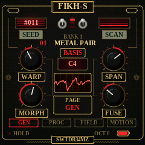
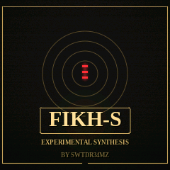

# FIKH-S

Experimental synthesis for the M-VAVE FM-1 by **swtdr34mz**, after the concept of the Forge TME VHIKK X: nine
algorithms for drones, basses, textures and noise, through a filter into a stereo processor, a metallic **DUNGEON** or
a diffuse **REFLEKTA** delay with a frequency shifter in its feedback. Built on
[fm1-base](https://github.com/charlesvestal/fm1-base) and [felucca-bsp](https://github.com/hugelton/felucca-bsp).

Unofficial: not made or supported by Forge TME or M-VAVE. No code, sound or artwork of Forge TME is used; the
algorithms are FIKH-S's own. At your own risk.

 

**Handbuch:** [Deutsch](docs/HANDBUCH.md) · **Manual:** [English](docs/MANUAL.md)

**Install:** download the `.fwsc` from [Releases](https://github.com/swtdr34mz-afk/FIKH-S/releases) and install it as
any FM-1 firmware. It runs on both FM-1 chips.

## The controls

| Control | What it does |
| --- | --- |
| Keys | **BASIS**: the root of every oscillator. Mono, the last key wins, with velocity |
| HOME | **GEN**: WARP, SPAN, MORPH, FUSE |
| FX | **PROC**: MIX, FEED, FORM, TIME |
| ENV | **FIELD**: FIELD (filter), CELL (frequency shift), ATTACK, RELEASE |
| EDIT | **MOTION**: GLIDE, DRIFT, WIDTH, LEVEL |
| SELECT | **SEED**: every detent a new throw of the dice (offsets, wave offsets, delay taps) |
| ALGORITHM | **SCAN**: scans random timbres, coarse for playing live |
| PRESET | The algorithm, 1 to 9 (BANK 1). Each keeps its own knobs |
| PLAY | **HOLD**: the VCA stays open, a drone; the keys only move BASIS |
| REC | **DICE**: a new SEED and SCAN. Held 1 s: MORPH, FUSE, FORM and TIME too |
| ARP | **FREEZE**: the processor keeps what it has, forever; new notes sound dry over it |
| SEQ held 1 s | The algorithm back to how it came |
| SAVE | Save (otherwise saved by itself when it is quiet) |
| OCT- / OCT+ | The octave of the keys |
| MIDI | Notes on any channel, pitch bend ±2, CC 1 = MORPH |

The bipolar knobs (WARP, SPAN, FUSE, FEED, FIELD, CELL) rest at their centre, neutral, for two detents.

## The algorithms (BANK 1)

| # | Name | Generator | Processor |
| --- | --- | --- | --- |
| 1 | METAL PAIR | two analogue-style oscillators; WARP: exponential FM / ring modulation | DUNGEON |
| 2 | SHAPER PAIR | phase modulation into a waveshaper (folder, saturation, Chebyshev) | REFLEKTA |
| 3 | SINE CLUSTER | six sines in a cluster, cross-modulated, ring-modulated neighbours | DUNGEON |
| 4 | WAVE QUAD | four wavetable oscillators; bit reduction, band-pass with a sine below | DUNGEON |
| 5 | DIATONIC | four voices quantised to a minor scale, scanned | REFLEKTA |
| 6 | CHORD SCAN | four voices playing ten chords, gliding between them, a phaser | DUNGEON |
| 7 | PARTIALS | eight partials, harmonic to odd-only, or stretched inharmonic | DUNGEON |
| 8 | COMB SWARM | a swarm of four feedback combs around BASIS | REFLEKTA |
| 9 | GRAIN CLOUD | a free cluster; the processor shifts its pitch in grains (CELL ±12 semitones) | REFLEKTA |

Every oscillator drifts on its own, left and right a little apart (DRIFT, WIDTH): the clusters breathe and stay
wide. If the CPU runs out (over 88 % for a second), FIKH-S plays with fewer oscillators and shows **ECO**.

## Building

    X0X_FONTSET=terminus python3 fm1-base/tools/build.py . --host
    for t in basic algos pages battery; do build/host/fikhs_host tests/$t.txt build/host; done

The firmware itself is built on GitHub (Actions), on every push to `main`, every pull request and every tag `v*`.
The sound core alone: `cc -O2 -Idsp -Ifm1-base/include tools/render_demo.c dsp/fikh_core.c -lm -o build/render_demo`.
The engraved serif faces come from `tools/gen_serif.py` (Liberation Serif Bold, SIL OFL 1.1).

## Licence

MPL-2.0 (LICENSE). The serif font: SIL Open Font License 1.1 (fonts/LiberationSerif-OFL.txt).
