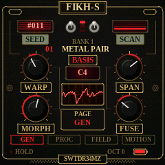

# FIKH-S – Handbuch

FIKH-S ist ein experimenteller Synth für das M-VAVE FM-1 von **swtdr34mz**, nach dem Konzept des Forge TME VHIKK X.
Er macht Drones, Bässe, Texturen und Geräusche. Ein **Generator** (einer von neun Algorithmen) läuft durch ein
Filter (**FIELD**) und einen VCA in einen **Prozessor**: ein Stereo-Delay mit einem Frequenzverschieber in der
Rückkopplung, entweder metallisch (**DUNGEON**) oder weich und diffus (**REFLEKTA**).

Inoffiziell: nicht von Forge TME oder M-VAVE. Es steckt kein Code, kein Klang und keine Grafik von Forge TME darin.

## Der Bildschirm

- **Oben links SEED**: das rote Fenster zeigt den Wurf (#000 bis #127).
- **Oben rechts SCAN**: die roten Streifen zeigen, wie weit SCAN steht.
- **Die Mitte oben**: zwei Kippschalter und drei LEDs, wie am Modul. Die Schalter zeigen den Algorithmus (3 × 3 = 9),
  die oberste LED die Bank. Darunter stehen die Nummer und der Name des Algorithmus.
- **Vier Regler**: die Regler der Seite. Der goldene Ring zeigt die Skala, das rote Licht im Ring den Wert. Bei den
  bipolaren Reglern geht es von der Mitte aus.
- **BASIS**: die Note, die klingt.
- **Das Scope**: das echte Ausgangssignal.
- **Die Anzeige darunter**: beim Drehen Name und Wert, sonst die Seite.
- **Unten**: die vier Seiten, HOLD (und FREEZE oder ECO), die Oktave und der Akku.

## Die Bedienung

| Bedienelement | Was es tut |
| --- | --- |
| Tasten | **BASIS**: der Grundton aller Oszillatoren. Mono, die letzte Taste gewinnt, mit Anschlag |
| HOME | Seite **GEN**: WARP, SPAN, MORPH, FUSE |
| FX | Seite **PROC**: MIX, FEED, FORM, TIME |
| ENV | Seite **FIELD**: FIELD, CELL, ATTACK, RELEASE |
| EDIT | Seite **MOTION**: GLIDE, DRIFT, WIDTH, LEVEL |
| SELECT | **SEED**: jede Raste ein neuer Wurf |
| ALGORITHM | **SCAN**: grob, damit man live schnell hinkommt |
| PRESET | der Algorithmus 1 bis 9. Jeder Algorithmus behält seine eigenen Reglerstellungen |
| PLAY | **HOLD** an/aus: der VCA bleibt offen, ein Drone. Die Tasten ändern dann nur noch BASIS |
| REC | **WÜRFELN**: neuer SEED und neuer SCAN. 1 s halten: dazu MORPH, FUSE, FORM und TIME |
| ARP | **FREEZE** an/aus: der Prozessor hält, was er gerade hat, endlos. Neue Noten klingen trocken darüber |
| SEQ 1 s halten | der Algorithmus zurück auf seine Werkseinstellung |
| SAVE | speichern. Sonst speichert FIKH-S von selbst, sobald es still ist (ein Schreibvorgang unterbricht den Klang kurz) |
| OCT- / OCT+ | die Oktave der Tasten (-2 bis +2) |
| MIDI | Noten auf allen Kanälen, Pitch Bend ±2 Halbtöne, CC 1 = MORPH |

Die bipolaren Regler (WARP, SPAN, FUSE, FEED, FIELD, CELL) sind in der Mitte neutral. Dort rasten sie ein: Zwei
Rasten bleibt der Wert stehen, erst die dritte geht weiter.

## Die Regler

| Regler | Was er tut |
| --- | --- |
| **WARP** | die Kreuzmodulation: links eine Art, rechts eine andere (je Algorithmus), in der Mitte keine |
| **SPAN** | Verstimmung und Spreizung der Oszillatoren; rechts kommt Stereo dazu |
| **MORPH** | fährt durch die Klangfarbe oder die Wellenform des Generators |
| **FUSE** | je Algorithmus, meist links Chorus oder Diffusion, rechts Sättigung oder Resonanz |
| **SEED** | würfelt Verstimmungen, Wellen-Versätze und die Abgriffe des Delays. Jede Stufe ist ein anderer Wurf, derselbe SEED klingt immer gleich |
| **SCAN** | fährt durch zufällige Klangfarben (je Algorithmus) |
| **MIX** | trocken und nass, in der Mitte beides gleich |
| **FEED** | die Rückkopplung des Delays. Links geht das verschobene Signal direkt zurück (Spiralen, Barberpole), rechts wird es mit dem rohen Delay gemischt (wandernde Kerben). Ganz außen hört es nicht mehr auf |
| **FORM** | von klar getrennten Echos zu einem diffusen Hall |
| **TIME** | die Länge des Delays, 5 ms bis 0,74 s. Beim Drehen gleitet sie, das Delay zieht die Tonhöhe mit |
| **FIELD** | das Filter: links Tiefpass, rechts Hochpass, die Mitte offen |
| **CELL** | die Frequenzverschiebung in der Rückkopplung. Um die Mitte ganz fein (langsames Schweben), außen bis ±600 Hz. Bei GRAIN CLOUD: die Tonhöhe ±12 Halbtöne |
| **ATTACK / RELEASE** | der VCA: wie er aufgeht und wie er schließt (1 ms bis 8 s / 5 ms bis 14 s) |
| **GLIDE** | wie BASIS von Note zu Note gleitet |
| **DRIFT** | jeder Oszillator wandert für sich (bis ±30 Cent), MORPH und SCAN atmen langsam mit |
| **WIDTH** | die Stereobreite |
| **LEVEL** | die Lautstärke des Algorithmus |

## Die Algorithmen (BANK 1)

1. **METAL PAIR** (DUNGEON): zwei analoge Oszillatoren. WARP links exponentielle FM, rechts Ringmodulation. SPAN der
   Abstand des Modulators (±2 Oktaven), MORPH die Welle des Trägers, SCAN die des Modulators (Puls, Säge, Sinus).
   FUSE links Chorus, rechts Filterresonanz.
2. **SHAPER PAIR** (REFLEKTA): ein phasenmodulierter Sinus durch einen Waveshaper. WARP links der Modulationsindex
   mit Rückkopplung des Modulators, rechts die des Trägers. SPAN die Trägerfrequenz. MORPH wie stark der Shaper
   arbeitet, SCAN seine Familie (Falter, Sättigung, Tschebyschow). FUSE links Modulation des Delays mit Audiorate,
   rechts Sättigung.
3. **SINE CLUSTER** (DUNGEON): sechs Sinus in einem Cluster. SEED würfelt die Abstände, SPAN spreizt sie. MORPH
   scannt über den Cluster. WARP links Phasen-Rückkopplung, rechts Kreuz-FM. SCAN Ringmodulation der Nachbarn.
   FUSE links Chorus, rechts Rauschmodulation.
4. **WAVE QUAD** (DUNGEON): vier Wavetable-Oszillatoren. MORPH fährt durch die Tabelle, SCAN versetzt jeden
   zufällig. WARP links Bitcrush, rechts Kreuz-FM. FUSE links ein Bandpass mit einem Sinus darunter, rechts Chorus mit
   Resonanz.
5. **DIATONIC** (REFLEKTA): vier Stimmen, in Moll quantisiert. SPAN spreizt sie in Tonleiterstufen (die Töne
   gleiten), MORPH scannt über die Stimmen, SCAN würfelt ihre Wellen. FUSE links Chorus, rechts Sättigung.
6. **CHORD SCAN** (DUNGEON): vier Stimmen spielen einen Akkord. MORPH scannt durch zehn Akkorde, die Töne gleiten.
   SPAN die Lage (rechts nach oben gespreizt und Stereo, links nach unten). WARP die Wellenform, SCAN ein Phaser.
7. **PARTIALS** (DUNGEON): acht Teiltöne. SPAN links unharmonisch gestreckt (Glocken, Metall), rechts von allen
   Obertönen zu nur ungeraden (hohl, Klarinette). MORPH scannt über die Teiltöne, SCAN würfelt ihre Lautstärken.
8. **COMB SWARM** (REFLEKTA): vier Kammfilter um BASIS, angeregt von Säge und Rauschen. SPAN spreizt ihre Stimmung,
   MORPH scannt über sie und hellt die Anregung auf, SCAN verstimmt sie zufällig. WARP links verrauschte, rechts
   gesättigte Rückkopplung.
9. **GRAIN CLOUD** (REFLEKTA): ein freier Cluster aus vier Stimmen. Der Prozessor verschiebt die Tonhöhe in Körnern:
   CELL ±12 Halbtöne, FORM die Korngröße. Mit FEED links liegt der Verschieber in der Schleife (das Signal steigt
   oder fällt mit jedem Durchlauf), rechts dahinter.

## Tipps

- **Ein Drone**: PLAY (HOLD), eine Taste, dann an MORPH, SCAN und FEED drehen. DRIFT um die Hälfte lässt den Cluster
  atmen.
- **Spiralen**: FEED nach links, CELL ein kleines Stück aus der Mitte.
- **Würfeln, bis es passt**: REC tippen. Gefällt ein Wurf, merkt man sich die SEED-Nummer.
- **Einfrieren und darüber spielen**: ARP (FREEZE), dann HOLD aus und mit kurzem RELEASE darüber spielen.

## Die Last

FIKH-S zeigt **ECO**, wenn die CPU länger als eine Sekunde über 88 % liegt. Dann rechnen SINE CLUSTER und PARTIALS mit
weniger Oszillatoren.
