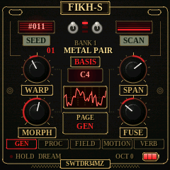

# FIKH-S – Manual

FIKH-S is an experimental synth for the M-VAVE FM-1 by **swtdr34mz**, after the concept of the Forge TME VHIKK X, for
drones, basses, textures and noise. A **generator** (one of 22 algorithms in three banks) runs through a filter (**FIELD**) and a
VCA into a **processor**: a stereo delay with a frequency shifter in its feedback, metallic (**DUNGEON**) or soft and
diffuse (**REFLEKTA**), then an ambient reverb after the Walrus Audio SLÖER.

Unofficial: not made or supported by Forge TME, Walrus Audio or M-VAVE. No code, sound or artwork of theirs is used.

## The screen

SEED's red window (top left) shows the throw, #000 to #127; SCAN's red stripes (top right) how far it is turned.
Between them, two toggle switches and three LEDs as on the module: the switches show the algorithm (3 × 3 = 9), the
top LED the bank, with the algorithm's number and name below. The four knobs of the page: the gold ring is the scale,
the red light in it the value (from the centre for the bipolar ones). BASIS shows the note sounding, the scope the
real output, the readout below it a knob's name and value while it turns, else the page. At the foot: the four
pages, HOLD (and FREEZE or ECO), the octave and the battery.

## The controls

| Control | What it does |
| --- | --- |
| Keys | **BASIS**: the root of every oscillator. Mono, the last key wins, with velocity |
| HOME | page **GEN**: WARP, SPAN, MORPH, FUSE |
| FX | page **PROC**: MIX, FEED, FORM, TIME |
| ENV | page **FIELD**: FIELD, CELL, ATTACK, RELEASE |
| EDIT | page **MOTION**: GLIDE, DRIFT, WIDTH, LEVEL |
| LFO | page **VERB**: MIX, DECAY, X, FILTER; again **VERB 2**: MODE, DEPTH, RATE, STRETCH |
| SELECT | **SEED**: every detent a new throw |
| ALGORITHM | **SCAN**, coarse, for playing live |
| PRESET | the algorithm, 1 to 22 (BANK 1: 1-9, BANK 2: 10-18, BANK 3: 19-22); each keeps its own knobs |
| PLAY | **HOLD**: the VCA stays open, a drone; the keys only move BASIS |
| REC | **DICE**: a new SEED and SCAN; held 1 s, MORPH, FUSE, FORM and TIME too |
| ARP | **FREEZE**: the processor and the reverb keep what they have, forever; new notes sound dry over it |
| SEQ held 1 s | the algorithm back to how it came |
| GLO | **VOL**: SEED's and SCAN's windows show the output, left and right; a red frame: clipping |
| GLO held 1 s | TIME the same for every algorithm (GLOBAL) or each its own (PER ALGO) |
| SAVE | save (otherwise saved by itself when it is quiet: a write stops the sound for a moment) |
| SAVE held + key | **store a snapshot**: the whole sound (algorithm, knobs, reverb, octave) on one of the first eight white keys |
| SEL held + key | **load the snapshot** |
| OCT- / OCT+ | the octave of the keys (-2 .. +2) |
| MIDI | notes on any channel, pitch bend ±2, CC 1 = MORPH |

The bipolar knobs (WARP, SPAN, FUSE, FEED, FIELD, CELL) are neutral at their centre and rest there for two detents.

## The knobs

| Knob | What it does |
| --- | --- |
| **WARP** | cross-modulation: one kind left, another right (per algorithm), none at the centre |
| **SPAN** | the oscillators' detune and spread; right adds stereo |
| **MORPH** | scans the generator's timbre or waveform |
| **FUSE** | per algorithm, mostly chorus or diffusion left, saturation or resonance right |
| **SEED** | throws the detunes, wave offsets and delay taps; each value is another throw, and always the same one |
| **SCAN** | scans random timbres (per algorithm) |
| **MIX** | dry and wet, both alike at the centre |
| **FEED** | the delay's feedback: left, the shifted signal goes straight back (spirals); right, it is mixed with the raw delay (moving notches). At the far ends it never stops |
| **FORM** | from distinct repeats to a diffuse reverb, denser and with the taps swimming more as it goes |
| **TIME** | the delay, 5 ms to 0.74 s; turning it glides, the delay bends the pitch |
| **FIELD** | a filter and timbral shaper in one: low-pass left, high-pass right, open at the centre; further out it shapes and emphasises more |
| **CELL** | the frequency shift in the feedback, very fine around the centre, up to ±600 Hz; GRAIN CLOUD: the pitch, ±12 semitones |
| **ATTACK / RELEASE** | the VCA (1 ms to 8 s / 5 ms to 14 s) |
| **GLIDE** | how BASIS glides from note to note |
| **DRIFT** | every oscillator wanders on its own (up to ±30 cents); MORPH and SCAN breathe with it |
| **WIDTH** | the stereo width |
| **LEVEL** | the algorithm's level |

## The reverb (VERB)

An ambient reverb after the Walrus Audio SLÖER at the end of the chain, the same for every algorithm (like a pedal):
eight delay lines feeding back into each other, slowly swimming in their lengths, diffused first. MIX (fully left:
off), DECAY 0.8 s to 30 s and INF fully right, FILTER its tone, DEPTH and RATE how it swims, STRETCH like a lower
sample rate (longer, darker tails, artefacts). MODE, one detent each:

| MODE | X |
| --- | --- |
| DREAM | lush; X a vibrato over the pad, FREEZE latches it |
| DARK | X: an octave down fed into the reverb |
| RISE | swells in after every note; X: how slowly (0.15 s to 6 s) |
| LIGHT | bright; X: an octave-up shimmer climbing in the tail |
| RAIN | little diffusion, the taps heard as echoes; X: more diffusion |

## The algorithms (BANK 1)

1. **METAL PAIR** (DUNGEON): two analogue-style oscillators; WARP exponential FM / ring modulation; SPAN the
   modulator's offset (±2 octaves); MORPH the carrier's wave, SCAN the modulator's.
2. **SHAPER PAIR** (REFLEKTA): phase modulation into a waveshaper; MORPH its drive, SCAN its family (folder,
   saturation, Chebyshev).
3. **SINE CLUSTER** (DUNGEON): six sines; SEED throws their intervals, SPAN spreads them, MORPH scans across, SCAN
   ring-modulates neighbours.
4. **WAVE QUAD** (DUNGEON): four wavetable oscillators; WARP bit reduction / cross FM; FUSE a band-pass with a sine
   below / chorus with resonance.
5. **DIATONIC** (REFLEKTA): four voices quantised to a minor scale, gliding between degrees.
6. **CHORD SCAN** (DUNGEON): ten chords scanned by MORPH; SPAN the voicing; SCAN a phaser.
7. **PARTIALS** (DUNGEON): eight partials, stretched inharmonic (left) or harmonic to odd-only (right).
8. **COMB SWARM** (REFLEKTA): four feedback combs around BASIS, excited by a saw and noise.
9. **GRAIN CLOUD** (REFLEKTA): a free cluster; the processor shifts its pitch in grains (CELL, FORM the grain size).

## The algorithms (BANK 2)

10. **ZERO CARRIER** (REFLEKTA): a carrier at 0 Hz, its phase moved through a wavetable by two modulators only.
11. **DISPERSOR**: four coupled sines; twelve allpasses in the delay loop make the echoes chirp (FORM, SEED).
12. **NOTCH STACK** (DUNGEON): two overdriven sines through four notches MORPH sweeps; SCAN a rectifier and folder.
13. **SINE SWARM** (DUNGEON): eight loose sines scattered by SEED.
14. **RADIO** (REFLEKTA): MORPH tunes across six stations (beeps, chirps, formant voices, chords) through static;
    WARP right the heterodyne whistle, left fading.
15. **WEATHER** (REFLEKTA): wind, rain and insects tuned to BASIS, MORPH between them.
16. **ARCHITECT** (DUNGEON): six modes MORPH rebuilds (string, bar, plate, bell, room), struck by every note and by
    itself (SCAN), bowed (WARP left).
17. **FOLD BASS** (DUNGEON): two saws and a sub through a wavefolder.
18. **SUPERSAW** (REFLEKTA): seven saws, MORPH to a drifting pulse.

## The algorithms (BANK 3)

19. **WAVE PM** (DUNGEON): four wavetable oscillators; WARP phase modulation / cross FM; FUSE chorus / chorus and resonance.
20. **WAVE FOLD** (REFLEKTA): the same; FUSE audio-rate modulation of allpasses and delay / a wavefolder per oscillator.
21. **METAL CLUSTER** (DUNGEON) and 22. **DIFFUSE CLUSTER** (REFLEKTA): four voices with cluster scanning.

## Cluster scanning

MORPH crossfades through a row of pairs of a frequency offset and a wave, a different row for every voice (SEED,
SPAN), as the module's guide describes. Every gain stage soft-clips.

## Snapshots

Eight whole sounds on the first eight white keys: SAVE held and a key stores, SEL held and the key loads. While
either is held the keys do not play; the stored ones light, the last one blinks.

## Load

FIKH-S shows **ECO** when the CPU stays over 88 % for a second: SINE CLUSTER and PARTIALS then use fewer oscillators.
